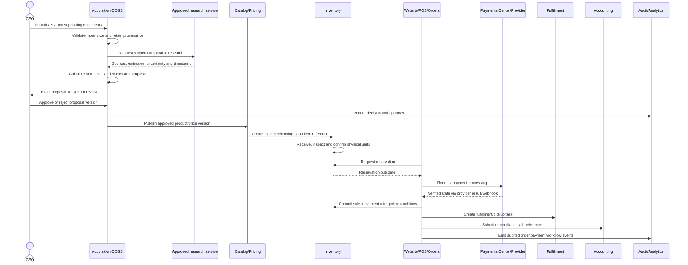

# Build 002 — Master System Architecture & Dependency Plan

**Platform:** Much More Electronics Operating System (MME OS)  
**Company:** Much More Electronics  
**Status:** Architecture blueprint for implementation review; not a production implementation  
**Authority:** CEO retains ultimate administrative and operational authority, subject to applicable law, security controls, and auditable procedures.  
**Relationship to Build 001:** Extends `docs/BUILD-001-ARCHITECTURE.md`; it does not renumber, replace, or declare complete any established build.  
**Repository verification:** The current repository has a Next.js storefront shell and placeholder routes. The architecture below is a target design, not a claim that the listed modules, integrations, database, or controls currently exist.

## 1. Purpose and architectural guardrails

Build 002 defines how MME OS capabilities should be organized, depend on one another, exchange data, and recover from failure. It provides the blueprint and review artifacts needed before implementation sequencing is approved.

- Modules communicate through authorized, versioned interfaces; no direct cross-module database writes.
- Every business record has an authoritative owner. Consumers use controlled read models and submit changes to the owner.
- Authentication, authorization, privacy, audit, data validation, and operational recovery are cross-cutting requirements.
- Financial commands are idempotent and reconcile against the processor and operational records. A browser redirect or unverified message is not payment evidence.
- AI proposals remain distinct from approved decisions and executed transactions. Required approvals are enforced by application policy outside the AI model.
- Preserve verified existing behavior, inspect before changing, and implement additively. Any migration or replacement requires explicit review and a rollback plan.
- Build numbers remain as already established in the MME OS roadmap. The sequence groups below are dependency groupings only, not new build numbers or a substitute roadmap.

## 2. Target architecture diagram

```mermaid
flowchart TB
  subgraph UX[Experience layer]
    WEB[Public website and e-commerce]
    PORTAL[Customer portal and accounts]
    EMP[Employee and POS experiences]
    CEO[CEO Command Center and executive dashboard]
  end

  subgraph ACCESS[Identity and governance]
    IAM[Identity Management and Identity Matrix]
    POLICY[Role, permission and approval policies]
    AUDIT[Central Audit Service]
    CONFIG[Governed configuration and module sequence administration]
  end

  subgraph DOMAIN[Business modules — authoritative domain services]
    CUSTOMER[Customer Accounts and CRM]
    CATALOG[Product Catalog and Demonstration Portal]
    INV[Inventory]
    ACQ[Acquisition, COGS and Pricing]
    SALES[Sales, Deal Desk, Quotes and POS]
    ORDER[Orders, Returns and Refunds]
    PAY[Payments, Stripe and Financing adapters]
    FULFILL[Shipping, Pickup and Local Delivery]
    PEOPLE[HR, Onboarding, Training and Timekeeping]
    FINANCE[Accounting, Payroll, Commissions and Financial Reporting]
    CONTRACTS[Contracts and E-signatures]
    MEMBERS[Subscriptions, Rewards and Auctions]
    SECURITY[Loss Prevention and Security]
    MKT[Marketing and Promotions]
  end

  subgraph INTEGRATION[API, events and automation layer]
    API[Versioned API gateway / module contracts]
    BUS[Durable event delivery, outbox/inbox and retry queues]
    WORKFLOW[Workflow orchestration and approval tasks]
    NOTICE[Notification Center]
  end

  subgraph DATA[Data and intelligence]
    DOMAINDB[(Module-owned operational data stores)]
    BI[Governed analytics and BI projections]
    FILES[Restricted document and media storage]
    SECRETS[Managed secrets and key service]
  end

  subgraph EXT[Approved external providers]
    STRIPE[Stripe / payment provider]
    TAX[Tax provider]
    SHIPPER[Shipping provider]
    ESign[E-signature provider]
    PAYROLL[Payroll provider]
    FINTECH[Financing provider]
    AI[Approved AI / research providers]
  end

  UX --> IAM
  UX --> API
  API --> POLICY
  API --> DOMAIN
  DOMAIN <--> DOMAINDB
  DOMAIN --> BUS
  BUS --> WORKFLOW
  WORKFLOW --> DOMAIN
  BUS --> NOTICE
  DOMAIN --> AUDIT
  POLICY --> AUDIT
  CONFIG --> AUDIT
  DOMAIN --> BI
  BUS --> BI
  ACQ --> FILES
  CATALOG --> FILES
  API --> SECRETS
  PAY <--> STRIPE
  PAY <--> TAX
  FULFILL <--> SHIPPER
  CONTRACTS <--> ESign
  FINANCE <--> PAYROLL
  PAY <--> FINTECH
  ACQ <--> AI
  CEO --> CONFIG
  CEO --> POLICY
  CEO --> BI
  CEO --> WORKFLOW
```

**Diagram note:** Logical boundaries are shown, not a commitment to a specific vendor, deployment topology, or microservice count. Build 002 recommends starting with clearly separated domain modules and contracts; Build 002 implementation planning must decide whether to deploy as a modular monolith or multiple services after evaluating team capacity, operational risk, scale, and cost.

## 3. Enterprise module map and dependency groups

This registry maps the requested capabilities to proposed architectural domains. Module names describe target capability, not current implementation. Build 001's registry remains the baseline inventory; the additional capabilities named in Build 002 are incorporated here.

| Domain | Module/capability | Primary responsibility | Main dependencies |
|---|---|---|---|
| Executive/admin | CEO Command Center, Executive Dashboard | Enterprise visibility, approvals and exception oversight | IAM, AUD, BI, workflow, all authorized domain read models |
| Executive/admin | Enterprise Administration, Module Sequence Administration | Governed configuration, release/sequence metadata | IAM, CFG, AUD, change control |
| Executive/admin | Identity Matrix / Role and Permission Management | Role definitions, grants, scope, access review | IAM, HR employment state, AUD |
| Executive/admin | CEO Internal AI Engine; CIO Elite Command Hub | Scoped analysis and operational recommendations | IAM, approved data products, AI governance, AUD; capabilities require owner and access policy |
| Executive/admin | Enterprise Meeting Management | Agendas, decisions, action items | IAM, workflow, notifications, AUD for material decisions |
| Commerce/customer | Website and E-commerce | Product discovery, cart and customer purchase experience | Customer identity, Catalog, Pricing, Inventory, Orders, PAY, fulfillment |
| Commerce/customer | Customer Portal and Customer Identity/Accounts | Profile, consent, orders and customer-visible service status | IAM, CRM, Orders, RET, subscriptions |
| Commerce/customer | Product Catalog and Demonstration Portal | Product descriptions, specifications, media and demonstrations | Catalog data, media storage, approved product publication |
| Commerce/customer | Subscriptions, Memberships and MME Rewards | Member status, benefits, rewards ledger/eligibility | Customer identity, PAY, Orders, Marketing, AUD |
| Commerce/customer | Auctions and Live Bidding | Listings, bids, reserve, close and settlement | IAM, Catalog, INV, PAY, Orders, subscription access |
| Commerce/customer | Marketing and Promotions | Campaigns, approved assets, offers and consent-aware outreach | Catalog, Pricing, CRM, consent, logo/brand settings |
| Sales/operations | CRM and Sales Management | Leads, relationships, sales activity | Customer identity, IAM, Deal Desk, consent, AUD |
| Sales/operations | Deal Desk and Quoting | Quotes, exceptions and approved commercial terms | CRM, Catalog, Pricing, inventory availability, Contracts, approvals |
| Sales/operations | POS | In-store basket, sale and tender initiation | IAM, Catalog, Pricing, INV, PAY, Orders, drawer/device integration |
| Sales/operations | Inventory Management | Units/quantities, locations, reservations, movements and receiving | Catalog, Acquisition, POS, Orders, Returns, fulfillment |
| Sales/operations | Auction Acquisition and COGS Engine | Intake, item normalization, per-item landed costs and proposals | Restricted document storage, Catalog, Pricing, AI research, CEO approval |
| Sales/operations | Returns and Refunds | Return authorization, inspection and disposition | Orders, PAY, INV, Shipping, Accounting |
| Sales/operations | Shipping, Local Delivery and Fulfillment | Shipment, pickup and delivery lifecycle | Orders, INV, provider integrations, notifications |
| Sales/operations | Loss Prevention and Security | Cases, signals, exception review and response | IAM, POS, INV, PAY, AUD, security monitoring |
| Financial | Payments Center and Stripe Integration | Processor references, payment/refund state, reconciliation | Orders, POS, provider webhooks, Accounting, AUD |
| Financial | Financing Center | Provider-mediated applications and financing outcomes | Customer identity, Deal Desk, Contracts, PAY, provider approval |
| Financial | Accounting and Financial Reporting | Journal entries, close, financial statements and reconciliation | PAY, POS/Orders, Returns, HR/Payroll, Commissions, INV valuation |
| Financial | Payroll | Payroll calculations or provider exchange and status | HR, timekeeping, commissions, Accounting, provider boundary |
| Financial | Commission Management | Commission rules, eligible events, calculations and approval | HR, POS/Orders, Returns, Accounting, AUD |
| Financial | MICR Check Printing | Controlled check output and reconciliation | Accounting, dual authorization, secure printer workflow, AUD |
| Financial | Funding and Working Capital Analytics | Forecasting and funding analysis | Accounting, inventory/COGS, sales, BI; restricted finance access |
| Workforce/admin | Human Resources and Employee Onboarding | Employment lifecycle and employee record | IAM, Contracts, payroll, training, access workflow |
| Workforce/admin | Training and Competency | Courses, completion evidence and role prerequisites | HR, IAM, task/notification service |
| Workforce/admin | Attendance and Timekeeping | Time records and approvals | HR, Payroll, IAM, AUD |
| Workforce/admin | Employee Tasks | Work assignment, status and escalation | IAM, workflow, notifications, module-specific records |
| Workforce/admin | Contracts and Electronic Signatures | Versioned documents and signature evidence | IAM, HR/CRM/Deal Desk, restricted file storage, provider |
| Workforce/admin | Employee Benefits and Discounts | Eligibility and controlled benefit application | HR, POS, Customer/Employee identity, policy, AUD |
| Workforce/admin | Disciplinary and Performance Records | Restricted HR case records and approvals | HR, role-scoped access, retention/legal policy, AUD |
| Intelligence | Enterprise Analytics and BI | Governed cross-domain projections, metrics and comparisons | Approved event/data products, lineage, access filters |
| Intelligence | AI Research and Automation | Scoped research, extraction and workflow assistance | Approved tools/data, policy, review/approval workflow, audit |
| Intelligence | Reporting and Comparisons | Authorized tables, charts, trends and exports | BI data products and role-scoped authorization |
| Intelligence | Notification Center | Operational and customer notifications | Workflow events, preferences, approved channels |
| Intelligence | Audit and Compliance Records | Attributable administrative and business events | All modules, restricted audit store and retention controls |

## 4. Dependency plan and sequencing

The following groups are dependency layers only. They do **not** create or renumber builds. The existing roadmap and approved build descriptions remain authoritative; where a capability's existing build number is not present in the repository documentation, this blueprint leaves it unassigned rather than inventing one.

| Dependency group | Capabilities needed before dependent production workflows | Exit evidence |
|---|---|---|
| 1. Enterprise foundation | Architecture decisions, data classifications, threat model, governance, IAM baseline, access policy, environments, secret handling | Approved ADRs, role matrix, security review, environment boundaries |
| 2. Shared platform services | Database/migration practices, API contracts, audit, notifications, event delivery/retry, monitoring, backup/restore | Contract tests, audit verification, retry/idempotency tests, restore evidence |
| 3. Core business records | Customer/account relationships, employee records, Catalog, locations and Inventory item/unit model | Owner and field authority, import validation, permission tests, reconciliation workflow |
| 4. Operational systems | Acquisition/COGS, CEO-approved Pricing, CRM, Deal Desk, quote workflows | Approval-bound proposal/version, cost allocation tests, audit trail |
| 5. Transaction systems | Website, POS, cart/orders, reservation, Payments/Stripe integration | Payment state machine, verified webhook, duplicate/replay and inventory tests |
| 6. Financial systems | Accounting, financing integration, payroll, commissions, MICR check controls | Reconciled test ledgers, separation of duties and provider test evidence |
| 7. Workforce systems | HR lifecycle, onboarding, training, timekeeping, contracts, benefits, performance records | Employee lifecycle tests, scoped access, retention and approval review |
| 8. Advanced operations | Auctions, subscriptions/rewards, returns, shipping/delivery, loss prevention | Cross-system workflow tests, exception queues, reconciliation and recovery evidence |
| 9. Intelligence systems | Analytics, AI research/automation, executive reporting and comparisons | Data lineage, permission-filter tests, AI governance, human approval tests |
| 10. Enterprise optimization | Advanced reliability, performance, automation coverage and provider resilience | Load/recovery evidence, SLO review, operational readiness sign-off |

A module may be developed earlier in a sandbox, but its production readiness depends on its prerequisites and acceptance evidence. A failed prerequisite cannot be bypassed by marking the dependent module “complete.”

## 5. System-of-record register and data handoffs

| Information/entity | Authoritative owner | Allowed consumers / update rule |
|---|---|---|
| Employee identity and employment status | HR for employment record; IAM for login identity and authentication state | IAM uses HR lifecycle events to propose/revoke employee grants; customer identity remains independently active unless separately changed |
| Roles, permissions and grants | Identity Matrix / IAM | Modules enforce grants server-side; changes are audited; modules do not self-grant access |
| Customer identity/account | Customer Account System / IAM identity link | CRM and portal consume authorized profile fields; changes route to owner; email is not a permanent record key |
| Product description/specifications/media metadata | Product Catalog | WEB/POS/CRM/BI consume approved versions; only catalog workflows publish edits |
| Available inventory, reservation and movement | Inventory Management | Sales channels request reservation/commit commands; they do not overwrite stock counts |
| Acquisition and landed cost | Acquisition/COGS Engine | Pricing/Accounting consume authorized cost outputs; source, allocation method and item-level derivation retained |
| Approved selling prices and markdowns | CEO-authorized Pricing System | Catalog, WEB, POS and auctions consume active approved price version; proposal is not an active price |
| Sales transaction/order | POS/Order Management by channel; a single order authority must be selected in Build 002 ADR | Other modules consume immutable order identifiers and versioned status events; channel conflict policy documented |
| Payment/refund status | Payments Center for MME payment workflow plus processor as authority for processor-side status | Order/Accounting consume verified state transitions and processor references; reconciliation resolves discrepancies |
| Refund and return disposition | Returns for eligibility/disposition; Payments for actual payment refund state | Return cannot report refunded until verified processor/payment state; inventory disposition is a separate explicit movement |
| Payroll record | Payroll | HR/Accounting receive minimum authorized status/summary; access and exports are restricted |
| Commission calculation | Commission Management | Payroll/Accounting consume approved calculation; returned/cancelled sale adjustments follow versioned rules |
| Accounting entry | Accounting | BI reads approved projections; operational modules submit source events, not direct journal writes |
| Subscription membership/status | Subscription Management | Customer Portal/WEB consume entitlement view; payment provider status is reconciled as required |
| Website presentation of order | E-commerce read model | Orders/POS remain transaction authorities; presentation status cannot override an order or payment |
| Enterprise audit history | Central Audit Service | Authorized reviewers read; source modules emit events; no ordinary role can alter prior audit entries |
| Promotion and marketing consent | Marketing/Customer preference authority (field ownership to be resolved in ADR) | Campaign execution checks current consent and active offer version at send/action time |
| Analytics | BI curated projection | Read-only derived view, not an operational source of truth |

### Data consistency rules

- Use opaque stable IDs, UTC timestamps, schema versions, explicit currency and units, and provenance for imported/researched values.
- Preserve business history through append-only events or versioned records. Corrections are compensating events/versions, not silent edits to financial history.
- Separate payment states: pending, authorized, captured, failed, partially refunded, refunded, disputed, and unknown/reconciliation-required as appropriate to the provider.
- A valid payment provider status is not itself proof that inventory, order, and accounting were synchronized. Track each workflow step and reconcile.
- Use decimal-safe money, explicit currency, and processor references. Never store raw card numbers or CVV.
- Restrict serial/IMEI identifiers as sensitive device data, mask ordinary displays/logs, and define purpose-based access and retention.
- Treat imported CSV, documents, model output and third-party data as untrusted; validate and preserve data provenance.

## 6. Integration and API register

Detailed endpoints and schemas are implementation decisions. This logical integration register establishes producer, consumer, command/event, and key protection requirements.

| Contract | Producer → consumer | Interface / key data | Required controls |
|---|---|---|---|
| Identity/authorization | IAM → all UI/API modules | Identity, role grant, resource scope, session status | OIDC/OAuth or approved equivalent, server authorization, revocation, audit |
| Catalog publication | Catalog → WEB, POS, CRM, BI | Published product/version/specification/media references | Versioned schema, approval state, validation, no unapproved publication |
| Inventory availability | INV → WEB/POS/Orders; reservation command back to INV | Availability view, reserve/commit/release, movement events | Atomic/concurrency-safe reservation, idempotency, expiry, reconciliation |
| Acquisition/pricing approval | ACP → Pricing/Catalog/INV | Item, cost allocation, comparables/source, proposal/version and approval | CEO-authorized approval bound to exact version; provenance; audit |
| Order lifecycle | WEB/POS/Orders → INV, PAY, SHP, CRM, ACC, BI | Order command and versioned status events | Idempotent creation, state machine, correlated events, retries and dead-letter/review queue |
| Payment/refund | Orders/POS → PAY ↔ Stripe/provider; PAY → Orders/ACC | Processor intent/reference, verified status, refund command/result | Server-created intent, signature verification, idempotency, no browser-trust, reconciliation |
| Returns/disposition | RET → PAY/INV/Orders/ACC | Authorization, inspection, refund request/status, stock disposition | Separate refund and inventory outcomes, permission and approval checks, immutable history |
| Fulfillment | Orders/INV → SHP/provider → Orders/customer portal | Shipment/pickup/delivery status and tracking reference | Provider auth, data minimization, retry/deduplication, customer notification policy |
| Customer/CRM | Customer Account → CRM/Portal/Marketing | Scoped customer profile, consent, relationship/status | Field-level authorization, consent freshness, access logging |
| Employee lifecycle | HR → IAM/Payroll/COM/Training | Employment state, approved roles/eligibility references | No customer-account deactivation side effect; restricted fields and lifecycle audit |
| Finance events | PAY/POS/Orders/Payroll/COM → Accounting → BI | Reconciled source reference, amount/currency, posting status | Segregation of duties, immutable references, reconciliation, decimal correctness |
| Subscription/auction | AUC/Subscriptions ↔ PAY/INV/Orders/Portal | Entitlement, listing, bid, reserve, settlement status | Eligibility/access policy, concurrency, payment and inventory checks, complete history |
| Notification | Authoritative module/workflow → Notification Center | Event, recipient reference, approved template, delivery result | Consent/channel checks, minimize sensitive content, retry and delivery audit |
| Analytics data product | Domain module/event stream → BI | Minimized, versioned data with lineage and freshness | Read-only, row/field access policy, privacy thresholds, export audit |
| AI tools | Approved business service ↔ AI provider | Scoped request/response, source provenance and proposal reference | Vendor review, data policy, tool scope, human gates, output validation and audit |

Every implemented contract must additionally specify owner, API/event version, authentication, authorization scopes, schema, rate limits, timeout, retry/backoff, idempotency key, ordering assumptions, correlation ID, error semantics, data classification, retention, test fixtures, monitoring, deprecation window, and rollback/decommission path.

## 7. Critical workflow maps

### 7.1 Acquisition to website or store sale

**Required exception paths:** invalid or ambiguous intake → review queue; unapproved price → not saleable; no received stock → only approved Coming Soon behavior; reservation conflict → no oversell; uncertain processor outcome → pending/reconciliation, not false completion; partial sync → retry idempotently and alert owner.

### 7.2 In-store sale and cash-drawer exception

Employee authentication → IAM checks role/location/action → POS loads current Catalog/Pricing and requests inventory reservation → POS submits payment through PAY → payment confirmation is obtained from trusted processor/PAY workflow → order/sale is recorded → INV commits movement → eligible immutable sale event is sent to COM and ACC → authorized dashboards update.

If payment state is uncertain, do not finalize as paid; reconcile. If the sale is valid but the cash drawer fails to open, preserve the sale/payment state, create a correlated IT incident and task, notify the assigned owner, and never retry the charge merely to reopen the drawer. Drawer command status and sale status are distinct records. Require a hardware integration and failure test before claiming this workflow works.

### 7.3 Customer financing

Employee retrieves only permitted customer information → Deal Desk creates financing request → financing provider returns application status through authenticated integration → required business/provider approvals and customer consent are recorded → Contracts obtains signature evidence as applicable → PAY receives only authorized payment instructions/status → Accounting posts according to approved accounting policy → Customer Portal displays the minimum permitted status. Financing decisions remain provider/business-authorized decisions; AI does not approve eligibility. Provider outage or uncertain status enters a review queue without implying approval.

### 7.4 Employee lifecycle

HR creates/updates employment record → Identity Matrix evaluates approved role assignment and required prerequisites → IAM provisions scoped employee grants and sessions → onboarding/training tasks are generated → authorized domain modules receive minimum necessary employment/eligibility events → HR termination/suspension triggers immediate policy-based employee grant/session review and revocation → Payroll/COM receive required status → customer identity/account remains separate and active unless independently changed → audit and access review are recorded.

### 7.5 Return, refund and inventory disposition

Customer/employee submits return request → RET validates authorization and policy → receipt/inspection records disposition → PAY submits idempotent refund and waits for verified outcome → INV separately records restock/quarantine/repair/write-off movement → Orders and customer view update with distinct return, refund and inventory statuses → Accounting reconciles. A refund failure must not be reported as completed; inventory must not be restocked solely because a refund was requested.

## 8. Identity, security, and CEO governance

### Identity and role boundaries

- Customer identity, employee relationship, employment status, authentication session, and role grants are distinct concepts.
- A person may hold customer and employee relationships under a verified login. Termination revokes employee access but does not deactivate the person's customer shopping account.
- Identity Matrix is authoritative for role definitions and grants; HR is authoritative for employment status. Modules enforce server-side resource/action scopes, deny by default, and log privileged actions.
- CEO permissions are a separately controlled privileged role, not an undocumented bypass. Sensitive actions require step-up authentication, reason/context, explicit approval where required, and tamper-evident audit records.
- Emergency access is time-limited, alerted, scoped, and subject to post-use review. Shared employee accounts are prohibited.

### Minimum security controls

TLS for all supported network traffic; managed encryption at rest for databases, backups and restricted files; secret/key management outside source control; environment separation; MFA for privileged accounts; secure session lifecycle; server-side authorization; input and output validation; upload scanning and restrictions; rate limits; dependency/security updates; scoped service credentials; signed webhook validation; idempotency and replay handling; sensitive-data masking; audit and monitoring; retention/deletion policy; backup/restore drills; incident response and escalation.

Privacy, financing, HR/payroll, payments, device identifiers, and third-party AI have distinct data access and retention boundaries. Applicable legal and processor obligations must be reviewed before production. This document is not a legal or PCI compliance attestation.

### CEO governance and approval model

CEO retains enterprise visibility, configuration/sequence governance, employee access control, approved pricing authority, critical financial/security/business approvals, and review of operational/financial performance. Proposals identify their exact version and impact; approval is invalid if that proposal changes. Where feasible, proposer, approver, and executor are separated. All overrides include reason, scope, duration where applicable, audit event, and post-action review. Legal requirements, safety controls, and processor constraints remain applicable.

## 9. AI and automation controls

- Each AI workflow has a named owner, purpose, permitted data/tools, provider and retention terms, evaluation measures, and stop procedure.
- Authorization is enforced by services before data is sent or actions executed; prompts cannot elevate permissions.
- AI output is labeled as a recommendation/proposal, carries source provenance and uncertainty, and is validated before use.
- High-impact pricing, financial authorization, personnel, access/security configuration, and strategic decisions require the designated human approval. CEO approval remains mandatory where specified by policy.
- AI cannot finalize payments, grants, termination actions, financing eligibility, or other protected decisions without explicitly approved, tested authorization policy; never treat an AI response as proof of execution.
- Human review, outcome monitoring, error/drift evaluation, audit, rollback or compensation path, and kill switch are required. Restricted data cannot be sent to a provider without security/privacy/contract approval.

## 10. Failure management and business continuity

| Failure class | Required behavior |
|---|---|
| API/provider timeout | Preserve intent and correlation ID; bounded exponential retry only for retry-safe operations; surface pending/unknown status and alert owner |
| Duplicate or replayed command/event | Deduplicate via stable idempotency key/event ID; return prior outcome without duplicate charge, order, refund, or movement |
| Out-of-order/duplicate event | Check entity version and valid state transition; quarantine or reconcile invalid transitions |
| Partial multi-module workflow | Track workflow state; retry individual idempotent steps; route unresolved items to owned exception queue; never claim overall completion prematurely |
| Payment state conflict | Reconcile processor against PAY and order; freeze unsafe repeat action; preserve evidence and notify Finance |
| Inventory mismatch | Block/limit affected availability by approved policy; reconcile physical and system movement; record adjustment actor and reason |
| Module outage | Document degraded mode and critical dependency; queue safe work; do not allow stale data to trigger unsafe financial or stock commitments |
| Security or privacy incident | Contain/revoke affected access or credentials; preserve restricted evidence; invoke incident response and notification obligations |
| Data corruption/deletion | Restore from protected backup or replay verified events; validate integrity and reconciliation before resuming writes |

Each module's operational runbook must name on-call/business owner, severity, dashboards, alert route, retry limits, queue ownership, recovery steps, customer/employee communications, RTO/RPO, and evidence needed to resume. Backups must be encrypted, access-controlled and restore-tested. Recovery is not verified until an exercise has demonstrated it.

## 11. Reporting, dashboards, and notification model

CEO Command Center and executive reports consume authorized, governed read models. Cross-module visibility does not grant unrestricted access to every underlying restricted field. BI provides tables, charts, trend comparisons, department and financial comparisons, sales/inventory analysis, history, and controlled exports with lineage and data freshness indicators.

Metrics require a versioned definition (owner, formula, currency/timezone, exclusions, source, freshness, and access scope). Operational modules do not accept BI writes. Notification events originate from authoritative changes; templates minimize sensitive content, verify channel preferences/consent, and track delivery, retries and failures. Export actions and access to sensitive executive/HR/financial data are audited.

## 12. Verification and implementation test plan

Tests are required at module, contract, integration, security and operational levels. Evidence must identify commit/release, environment, test data, execution result, and reviewer. Use synthetic/test data except in explicitly authorized, privacy-controlled production verification.

| Test category | Minimum scenarios / evidence |
|---|---|
| Architecture/contracts | Contract schema compatibility, versioning/deprecation, owner and system-of-record enforcement, unauthorized direct-write rejection |
| Identity/access | Customer vs employee separation; termination revokes employee grants/sessions but preserves customer access; deny-by-default; location/record scoping; MFA/step-up; service-account scope |
| Approval/audit | CEO pricing approval binds to exact version; modified proposal invalidates approval; high-impact access/config changes require policy; actor, reason, before/after reference and outcome audited |
| Acquisition/pricing | Malformed CSV/file, duplicate item, source provenance, per-item cost allocation, missing data/uncertainty, reject/approve, receiving mismatch and Coming Soon status |
| Inventory/concurrency | Simultaneous reservations, expiration/release, POS/web contention, receiving, return disposition, duplicate movement, reconciliation and outage behavior |
| Payments/orders | Signed and invalid webhook, replay, duplicate request, browser redirect without webhook, pending/unknown/captured/refunded/disputed states, timeout, partial refund, reconciliation, no raw card/CVV storage |
| POS/device | Payment/order success with drawer failure; no duplicate charge on drawer retry; hardware unavailable; incident task and correlation ID |
| Financing/contracts | Provider pending/denied/timeout, customer consent, signature evidence, unauthorized record access, no AI eligibility approval |
| HR/payroll/commission | Role-color uniqueness if retained as a feature, employment lifecycle, restricted record access, termination propagation, reversal/return commission adjustment, payroll export authorization |
| Privacy/security | Sensitive-data masking, upload validation, rate limit, session revocation, secret scanning, dependency checks, export audit, retention/deletion behavior |
| Reliability/recovery | Retry limits, dead-letter/review queue, duplicate/out-of-order events, monitoring alert delivery, backup restoration, integrity and reconciliation, documented RTO/RPO exercise |
| BI/AI | Data lineage/freshness, row/field authorization, export audit, consent checks, prompt/tool privilege boundary, untrusted input, source provenance, human approval, kill switch |
| UI/accessibility | Desktop/mobile responsive paths, keyboard and screen-reader access, error states, accessible labels, no false transaction success presentation |

Do not test live financial transactions until a controlled production plan, authorized transaction, secure credentials, verified webhook, reconciliation procedure, refund procedure, and responsible operator are in place.

## 13. Implementation instructions and change control

Before a code change, inspect the existing repository, project configuration, routes, data stores, deployment setup, and current tests. Record verified behavior and gaps. Do not infer integrations from this blueprint. Do not reset or replace existing app/data. Prefer isolated, additive changes with reviewable commits and tests. Introduce dependencies only with justification, ownership, version/update plan, and security review. Document migrations, rollback, secrets/configuration, and incomplete integration states.

Any new architecture decision must be recorded as an ADR with context, decision, alternatives, consequences, owner and date. Existing build numbers and approved descriptions remain unchanged. The current repository was checked only as represented by its committed files; no Replit runtime, deployment secrets, external systems, production domain, live Stripe account, or live transactions were verified as part of this document.

## 14. Build 002 acceptance criteria and completion evidence

Build 002 is ready for implementation review when these artifacts have been reviewed by business and technical owners:

- [ ] Architecture diagram and module map include every capability named in this blueprint.
- [ ] Module dependency matrix identifies prerequisites and measurable exit evidence, while preserving all established build numbers.
- [ ] System-of-record register names authoritative writers, read consumers, boundaries, and unresolved ownership ADRs.
- [ ] Critical workflow maps show data handoffs, approval gates, failure paths, and recovery/reconciliation.
- [ ] API/integration register identifies producer/consumer, data, security, version, idempotency, retry, monitoring, and owner requirements.
- [ ] Security and identity model documents role boundaries, CEO governance, customer/employee separation, sensitive data, and provider constraints.
- [ ] Test plan includes financial correctness, duplicate prevention, access control, recovery, and user experience evidence.
- [ ] Open decisions have accountable owners and resolution milestones before dependent production implementation.
- [ ] Documentation is committed additively and no capability is described as implemented without code and verification evidence.

**Completion evidence deliverable:** This blueprint supplies the logical architecture diagram, module/dependency matrix, system-of-record register, API/integration register, workflow maps, security/governance model, failure plan, and test plan. It does not by itself establish that Build 002 implementation review or production implementation is complete. A review sign-off and resolution log for open decisions remain necessary.

## 15. Open decisions for review

1. Modular monolith versus independently deployed services, deployment/hosting and scaling model.
2. Database and migration stack, event transport, API gateway, object storage, IAM provider, audit storage, and observability tools.
3. Definitive service ownership for order records, customer profile fields/consent, active pricing, payment/refund state, and audit retention.
4. Legal jurisdictions, PCI scope assessment, privacy and data retention, HR/payroll, financing, MICR/check controls, and third-party vendor obligations.
5. Approval limits, segregation of duties, CEO delegation, emergency access, access-review cadence, and role color rules.
6. Provider selection, failure/timeout contracts and data-sharing terms for Stripe, tax, shipping, financing, e-signatures, payroll, and AI.
7. RTO/RPO, availability, incident response/on-call ownership, backup retention, and recovery exercise cadence by module.
8. Existing approved build-number mapping for modules where the roadmap is not currently present in this repository. Do not assign new numbers without approval.
9. Definition/ownership of module sequence administration and CIO Elite Command Hub, including scope and separation from CEO-only authority.
10. Event delivery guarantees, entity version/conflict policy, data residency and analytics export requirements.

## 16. Current implementation boundary

The existing MME OS repository is a storefront scaffold with placeholder product and account pages. This Build 002 artifact is architecture documentation only. No centralized identity matrix, enterprise database, module APIs, event system, audit service, POS, payments, financing, accounting, HR/payroll, AI engine, monitoring, backup, or external provider integration is established or verified by this document. Those features need additive implementation and evidence-based acceptance in their approved builds.
