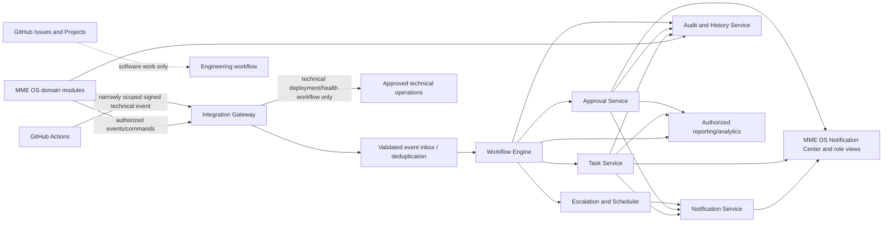

# Build 006 — Enterprise Notification, Task & Workflow Automation Engine
## GitHub Platform Edition

**Company:** Much More Electronics  
**Platform:** GitHub for source control and approved development automation; MME OS backend for business workflows and authoritative records  
**Build number:** 006  
**Status:** Specification for implementation review; not implemented  
**Authority:** CEO, enforced through MME OS Identity Matrix, approval policies, and auditable controls  
**Dependencies:** Builds 001–005  
**Repository:** `lynchcous-wq/mme-os`

## 1. Purpose and architecture boundary

Build 006 defines a centralized MME OS notification, task, approval, escalation, scheduling, and workflow engine. It makes cross-module responsibilities visible without making GitHub the business task database.

**Boundary rule:** GitHub repositories, Actions, Issues, Projects, Environments, and webhooks support software development and approved technical operations. MME OS application services own business tasks, approvals, notifications, workflow executions, and related business records. GitHub Actions may invoke a narrowly scoped, authenticated MME OS endpoint for an approved technical event; they must not independently authorize or execute sales, payments, refunds, payroll, HR, inventory, customer, or other business transactions.

GitHub Issues and Projects are for software defects, engineering requests, technical incidents, milestones, and release planning only. Do not put customer records, employee/personnel information, payroll, payment credentials, confidential commercial records, or business task payloads into GitHub issues, project fields, commit messages, workflow logs, or artifacts.

This document is a target specification. The current repository has a storefront shell and documentation; no notification/task/workflow backend or Actions integration is claimed to exist. Repository configuration and runtime settings must be inspected before implementation.

## 2. System architecture

### 2.1 Application services

1. **Notification Service:** creates, routes, delivers, deduplicates, acknowledges, and tracks in-app and approved external notifications.
2. **Task Management Service:** owns business task records, assignments, deadlines, instructions, evidence references, state transitions, and history.
3. **Workflow Automation Engine:** executes versioned business workflows from authorized domain events and commands.
4. **Approval Management Service:** records requests, policy, authorized decision, reason, version-bound proposal, and outcome.
5. **Escalation Engine:** evaluates due dates/business calendars and applies approved reminder/escalation rules.
6. **Scheduling Service:** runs business schedules independently of GitHub Actions and records execution/failure state.
7. **Audit and History Service:** maintains protected, attributable records of material actions and state changes.
8. **Integration Gateway:** authenticates and validates module/provider/webhook inputs, enforces scopes, correlation, idempotency, and rate limits.
9. **Reporting and Analytics Service:** provides authorized workflow/task/alert summaries and performance metrics from governed data.

### 2.2 Logical flow

The diagram describes intended boundaries. It does not choose a deployment topology, queue vendor, database, or runtime scheduler. Those decisions require implementation ADRs.

## 3. GitHub platform responsibilities and safeguards

| GitHub component | Appropriate responsibility | Prohibited/limited use |
|---|---|---|
| Repositories | Version application source, workflow definitions, integration docs, infrastructure/configuration-as-code and reviewed changes | No production secrets, customer/employee/payroll/payment data, or sensitive business transaction payloads |
| GitHub Actions | Build/test/lint/security checks, approved deployment workflow, dependency checks, technical health checks and repo maintenance | Not a durable business scheduler or authority for business task/approval/payment/inventory/payroll execution |
| GitHub Issues | Software defects, technical incidents and engineering requests | Not MME employee task records or customer/personnel/financial case management |
| GitHub Projects | Engineering milestones, release planning and development progress | Not employee productivity or business workflow task storage |
| GitHub Webhooks | Deliver selected, validated repository/deployment events to an authenticated integration endpoint | Never trust an unauthenticated payload or allow a repository event to authorize a business transaction |
| GitHub Environments | Separate deployment targets, secrets/scopes and required production approvals | Approval applies to deployment only; it is not approval for business operations |
| CODEOWNERS/review rules | Route source/config review to accountable maintainers | Does not replace runtime IAM or CEO approvals inside MME OS |

### 3.1 Actions and repository security

Before enabling workflows, review the repository owner/settings and available plan features. Configure, where supported and approved:

- Protected production branches/rulesets, required reviews/checks, restricted force push/deletion, and tagged release controls.
- CODEOWNERS for application, infrastructure, workflow and security-sensitive configuration.
- Least-privilege workflow permissions; set default `GITHUB_TOKEN` permissions to read-only where feasible and grant individual jobs only required scopes.
- Pin third-party Actions to reviewed immutable commit SHAs where practical; update through reviewed dependency changes.
- Separate development, staging and production environments; require authorized reviewers for production deployment and protect environment secrets.
- Use GitHub OIDC with audience/subject restrictions and short-lived cloud credentials where the deployment provider supports it; otherwise rotate and scope stored credentials.
- Avoid secrets in echo output, artifacts, URLs, test reports, caches and error messages. Masking is not a substitute for never emitting secrets.
- Enable available dependency, secret and code scanning; define alert ownership and remediation SLAs. Verify feature availability for the repository plan rather than assuming it.
- Restrict repository administration, Actions policy, webhook management and environment approval changes; review GitHub audit logs according to organizational access and retention.
- Keep development/staging/production data and credentials separate. Production deployment requires approved change and rollback instructions.

### 3.2 Webhook security

GitHub webhooks use TLS and provider signature verification against the raw request body, a secret held outside source control, timestamp/replay controls where supported, event allowlists, repository/installation identity checks, schema validation, request-size limits, rate limits, and event-ID deduplication. Respond quickly after durable acceptance; process asynchronously. A valid signature proves origin/integrity under the configured secret, not business approval. Webhook payloads should contain only the minimum technical references needed; fetch further data through a scoped API if authorized. Never expose raw webhook secrets or payloads with sensitive information in logs.

## 4. Core data model and event envelope

Business records reside in MME OS backend storage, with module/system-of-record rules from Builds 001/002.

| Record | Minimum responsibilities |
|---|---|
| Notification | Unique ID, category, priority/severity, source, description safe for recipient, recipient/department, related reference, state, due/action, timestamps and resolution history |
| Task | Title/instructions, department, assignee/supervisor, priority, start/due time, estimate, authorized attachment references, related business reference, approvals, completion criteria, status and history |
| Task Assignment | Task, assignee/scope, assigner, effective date, acceptance state, reassignment reason and history |
| Workflow Definition | Stable ID, version, owner, trigger, permitted actions, state graph, approval requirements, retry/timeout, cancellation/rollback and effective status |
| Workflow Execution | Definition/version, event/correlation IDs, current state, step outcomes, retries, failure reason, actor/service, timestamps and terminal result |
| Approval Request | Requester, approver policy, exact proposal/record version, requested action, decision/deadline, reason, outcome and audit reference |
| Escalation | Rule/version, target, level, trigger time, recipient, action, acknowledgement, resolution and history |
| Scheduled Job | Job definition/version, schedule/timezone/calendar, next/last run, outcome, idempotency key and retry state |
| Automation Event | Stable event ID/type/schema, producer, entity/version, occurred/received times, actor/service, correlation ID and minimized payload |
| Integration Status | Provider/module, health/freshness, last success/failure, error class, queue depth and owner |
| Audit Event | Actor, action, target, outcome, timestamp, reason/approval reference, correlation, and permitted before/after values or hashes |

Every event uses a versioned envelope: `event_id`, `event_type`, `schema_version`, `producer`, `occurred_at`, `received_at`, `actor` (user/service), `entity_type`, `entity_id`, `entity_version`, and `correlation_id`. Payloads are minimized and schema-validated. Sensitive data should be referenced through authorized opaque IDs rather than copied into notifications or task descriptions.

Tasks and workflows need explicit ownership, retention and deletion rules. Attachments are stored in approved MME OS storage with role/access checks, malware/type/size validation and audit; GitHub artifacts are not a business-record attachment store.

## 5. Notification Center

### 5.1 Categories and fields

Categories: Sales, Inventory, Warehouse, Accounting, Payments, Payroll, Human Resources, Customer Service, Returns and Refunds, Website and E-commerce, Marketing, Loss Prevention, IT, and Executive Operations.

Each notification records unique ID, category, priority, creation time, originating module, safe description, assigned department/employee, related record reference, status, required action, due date when applicable, and resolution history. Related references resolve only after authorization; descriptive text must not leak the record itself.

Statuses: New, Read, Acknowledged, In Progress, Waiting for Approval, Escalated, Resolved, Closed, Cancelled. Define allowed transitions, actor permission, and history. Read/acknowledged are distinct from resolved; notifications do not imply that the underlying business process is complete.

### 5.2 Delivery and preferences

Channels may include in-app, email, SMS, authorized push, and management dashboards only after a provider, privacy, consent, delivery, and security review. Preferences may be set by role and user, but critical security/financial alerts follow company policy and cannot be silently disabled by ordinary users. Use safe generic previews; avoid sensitive customer, employee, payment, HR, or incident details in email/SMS/push. Track delivery and failure separately from business task status. Retry delivery safely without creating duplicate notifications.

## 6. Task Management Service

Tasks can be created by authorized users or approved workflow triggers. Required fields include title, detailed instructions, department, assignee, supervising manager, priority (Critical/High/Normal/Low), start/due time, estimate, permitted attachment references, related business record, required approvals, completion requirements, and full task history.

Statuses: Not Started, Assigned, Accepted, In Progress, Pending Information, Pending Approval, Completed, Rejected, Overdue, Cancelled. Define a validated state machine; overdue may be a derived deadline condition or explicit state, but it must not erase the underlying work state. Completion requires stated criteria/evidence when applicable. Reject, cancel, reopen and reassign actions need appropriate permissions and reason.

Authorized managers may reassign tasks, change deadlines, add instructions, escalate, request information, or close tasks. Each material update records actor, timestamp, previous/new values, reason, source and approval reference if required. Do not automatically initiate disciplinary action based solely on overdue status or automated productivity scoring.

## 7. Workflow engine and approvals

### 7.1 Workflow execution standards

- Workflows are versioned, owned, approved before activation, and have explicit triggers, preconditions, permitted actions, states, timeout, retry, cancellation, compensation and human approval rules.
- Validate input events and actor/service scope. Workflow actions call authorized module APIs; no direct database writes or permission bypass.
- Use idempotency keys and durable inbox/outbox processing. Assume at-least-once delivery; deduplicate events and commands. Record every step outcome and correlation ID.
- Separate workflow state from source business state. A workflow being complete does not prove a payment, refund, sale, or inventory adjustment succeeded; require authoritative confirmation.
- Retry only safe operations with bounded exponential backoff and jitter; send poison/ambiguous events to an owned failure queue for review. Replay requires authorization, idempotency, and audit.
- Support pause/kill switch for unsafe automation. Suspending automation must not discard in-flight business work or falsify task status.

### 7.2 Approval Management

Supported types include inventory purchases, pricing changes, refunds, high-value transactions, employee access, payroll exceptions, financial adjustments, contracts, security exceptions and website promotions. CEO or authorized administrators configure policies, thresholds, eligible approvers, separation-of-duties requirements, deadlines and delegation.

Each approval records requester, exact request/proposal version and related record, approver/policy, request and decision times, decision, reason, audit reference, and notification state. If the proposal changes, prior approval is invalidated and the updated version must be reviewed. Approval is a decision record, not execution; the owning module performs the action and returns its authoritative outcome. AI recommendations are visibly separate and cannot authorize restricted actions.

## 8. Escalation and business scheduling

Escalation rules support department-specific deadlines, business-hour/holiday calendars, critical incident paths, multiple levels, reminders, reassignment and exceptions. Example: assignee → reminder before due → overdue state → manager → executive for configured severity → CEO for critical policy-defined cases. Configure recipients and thresholds by role/scope and avoid unnecessary notification storms.

Escalation is operational routing, not punishment or an automated disciplinary decision. Provide acknowledgement, snooze/exception with reason where permitted, reassignment, resolution and history.

Business scheduling runs through the MME OS backend scheduler or an approved external scheduler, not GitHub Actions. Examples include daily opening/closing tasks, weekly management reports, monthly inventory review, payroll reminders, subscription renewal notices and training reminders. Scheduler jobs must be timezone-aware, idempotent, monitored, recoverable, and continue during GitHub Actions outages. Missed-run policy must specify catch-up, skip or manual review.

GitHub Actions schedules are appropriate for repository tests, dependency/security scans, deployment checks, technical integration health checks and approved technical reports. Avoid relying on scheduled Actions for time-critical or durable business obligations.

## 9. Required workflow patterns

These are logical patterns, not evidence that the source integrations exist. “Wix” and any other commerce platform must be selected and verified; do not assume an integration is configured.

### A. Inventory shortage

Inventory emits authoritative low-stock event → gateway validates/deduplicates → workflow creates scoped alert and warehouse task → manager reviews stock → system may propose replenishment with provenance → purchasing approval is requested if required → approved purchasing action goes through its owner → inventory receipt confirms resolution → task/alert closes only after authoritative state update.

### B. Failed payment

Payments Center receives provider response/webhook → signature and event are validated → payment state updates under PAY authority → idempotency prevents duplicate charge → reconciliation alert is created if affected → Customer Service task is created only when needed and permitted → retry/alternate payment follows approved policy and customer consent → final state reconciles. A failed/unknown status is never shown as paid.

### C. Cash drawer failure

POS records sale and drawer outcome as distinct events → drawer failure creates correlated critical IT alert and manager notification → IT task is assigned → repair/replacement evidence is recorded → closure follows device verification. Do not retry the payment just to open the drawer or make the sale status depend on the drawer operation.

### D. New employee onboarding

HR approval creates employee relationship → Identity Matrix proposes/provisions only approved access → manager onboarding tasks and training/document assignments are created → approved integrations provision independently → completion events return to HR. Employee/customer identities remain separate and termination later revokes employee access without automatically closing customer access.

### E. Website order

Configured commerce platform emits event → integration validates source, signature/credentials and order reference → MME OS validates order through its business service → inventory reservation and payment verification occur through their authorities → fulfillment/pickup task is created → customer notification uses consent-safe channel → portal status follows authoritative fulfillment events → Accounting/analytics consume approved transaction events. No platform event alone proves payment or inventory completion.

### F. Returns and refunds

Return request creates RET record and inspection task → item/serial checks occur under permission → approval policy determines eligibility → PAY initiates refund only after approval and verified order reference → inventory condition/disposition updates separately → customer receives non-sensitive status → audit history and reconciliation record outcome. A requested refund is not a completed refund, and a refund does not automatically restock inventory.

## 10. CEO Command Center and department views

CEO workflow overview supports enterprise task/overdue/critical alert views, approvals, cross-department assignment, status requests, reassignments, escalation configuration, completion/bottleneck metrics, automation failures, suspension of unsafe automation, and authorized audit history. CEO actions remain subject to strong authentication, confirmation, scope, source-module approval policy, and immutable audit.

Departmental queues may include Sales follow-up/CRM, Accounting reconciliation/refunds, Warehouse receiving/picking/shipping/discrepancies, HR onboarding/training/authorized attendance exceptions, IT failures/hardware/integrations/security, and Loss Prevention cases/evidence. Employees see only assigned work and authorized notifications; managers see their explicit department/location scope. CEO visibility does not mean unrestricted HR or security evidence access.

## 11. GitHub-to-MME OS integration contract

For approved technical repository/deployment events, use a dedicated integration endpoint with a narrow service identity. Contract requirements:

- Allowlist event types and repository/installation IDs; verify signatures and schema.
- Include GitHub delivery/event ID, repository, workflow/run reference, commit SHA, environment, event time and correlation ID; exclude secrets and business data.
- Enforce replay protection, idempotency, timeouts, rate limits, bounded retries, durable acceptance and deduplication.
- Map repository events only to technical notification/task types (for example failed deployment or release readiness task). The event must not directly invoke a financial or operational business command.
- Record received/validated/rejected/processed outcome and link to a safe GitHub run URL only for authorized engineering users.
- Keep webhook secret in MME OS secret management; rotate and test rotation/revocation.
- On integration failure, GitHub workflow and MME OS service expose independent health/error state; core POS/payments/inventory/payroll operations continue.

## 12. Failure handling, reliability, and audit

| Failure | Required behavior |
|---|---|
| Duplicate event/command | Deduplicate by stable event/idempotency key and return recorded outcome; no duplicate task, notification, payment, refund or movement |
| Provider/API timeout | Mark pending/unknown; bounded safe retries; retain correlation and route unresolved item to owner |
| Notification delivery failure | Keep business notification/task durable; retry delivery separately; expose delivery failure and escalation without cancelling task |
| Invalid/unauthorized event | Reject/quarantine, audit safe metadata, alert integration owner; do not execute workflow |
| Partial workflow failure | Preserve step state, retry idempotent steps, compensate only through approved source-module operation, assign exception queue |
| Dead-letter/replay | Restrict access, require reason/authorization, test idempotency and audit replay/result |
| Scheduler outage/missed run | Backend health alert, documented catch-up/skip policy, owner review; GitHub outage does not stop core business scheduling |
| Unsafe automation | Authorized CEO/admin can pause/disable version; preserve in-flight state, notify owners and document recovery |
| Audit or storage outage | Apply approved fail-closed/fail-safe policy by action risk; do not silently perform privileged/financial actions without required audit evidence |

Central audit records include actor/service, workflow/task/approval ID, action, target, timestamp, reason, previous/new version/status, correlation/event ID, outcome and approver reference. Logs must not contain credentials, full payment data, unnecessary employee/customer information, or unrestricted attachment content. Define retention, tamper detection, access, backup and incident response.

## 13. Implementation phases

### Phase 1 — GitHub foundation

Inspect repository settings and existing workflows; confirm ownership and plan features. Propose branch rules, CODEOWNERS, least-privilege Actions permissions, environment separation, secrets/OIDC, security scanning, release and audit practices. Apply settings only after authorized review; document controls that are unavailable or not enabled.

### Phase 2 — Application services

Select data store, event transport, scheduler, service identity and observability in ADRs. Implement Notification, Task, Workflow, Approval and Escalation services with schema validation, state machines, audit, idempotency, authorization, retries and failure queues.

### Phase 3 — MME OS interface

Add notification center, task dashboard, approval queue, departmental views and CEO workflow overview using Identity Matrix permissions and Build 005 dashboard conventions. Preserve existing storefront routes and functionality.

### Phase 4 — Integrations

Integrate POS, Inventory, Payments Center, Accounting, HR, Payroll, commerce, CRM and approved communication providers one at a time through contracts and sandbox/test evidence. Do not assume Wix or any integration exists; verify platform and provider selection first.

### Phase 5 — Automation

Activate versioned triggers, business schedules, reminders, escalations and recovery playbooks. Use staged rollout, feature flags, monitoring and kill switch. Start in observe/dry-run mode where appropriate.

### Phase 6 — Test and release

Test permissions, assignment, approval/version binding, duplicate events, webhook validation, retries, delivery failure, escalations, scheduler outages, replay, recovery, audit integrity, notification privacy, and continued business operation when GitHub is unavailable. Production deployment requires authorized environment approval and rollback plan.

## 14. Security and privacy requirements

- Identity Matrix authorization on all task, notification, workflow, approval, escalation, attachment, report, replay and admin operations.
- Least-privilege roles and scoped service identities; MFA/step-up for privileged administration; session revocation and access review.
- TLS, encryption at rest for business records/attachments/backups, managed secrets, environment separation and rotation.
- Input validation, safe output encoding, upload scanning/limits, CSRF/session protections as applicable, rate limits and abuse monitoring.
- Notification content minimizes sensitive data; delivery preferences do not silence mandatory critical alerts contrary to policy.
- GitHub contains no secrets or business personal/financial data; Actions logs/artifacts are reviewed for leakage and retention.
- Separate technical audit from business audit while linking through correlation IDs. Restrict audit access and protect against tampering.
- Apply retention, deletion, consent, access and legal-hold rules; obtain privacy/security/provider review before email/SMS/push, AI, payroll or external integrations.

## 15. Acceptance criteria and verification plan

Build 006 is ready for implementation approval when evidence demonstrates:

- [ ] GitHub/MEE OS responsibility boundary is documented and enforced; Issues/Projects are not used as employee/business task databases.
- [ ] GitHub repository/workflow security settings are inspected, configured where approved/available, and verified without claiming unsupported controls.
- [ ] Notification, task, workflow, approval, escalation, scheduler, audit, integration and reporting services have owners, schemas, authorization, retention and operational runbooks.
- [ ] Employees see only authorized notifications/tasks; manager/department/CEO views respect Identity Matrix and sensitive-data scope.
- [ ] Task assignment, reassignment, deadlines, transitions, completion evidence and material history are auditable.
- [ ] Approval is bound to an exact proposal version; changed proposals invalidate approval; approved decisions do not falsely imply execution.
- [ ] Event IDs/idempotency prevent duplicate notifications/tasks and protect business commands against duplicate processing.
- [ ] Failed payment, cash drawer, onboarding, shortage, order and return workflows are tested with success, failure, timeout, duplicate and partial-completion cases.
- [ ] Webhook signatures, event allowlists, replay, repository identity, payload validation and secret handling are tested.
- [ ] Business schedules continue independently of GitHub Actions availability; missed-run behavior is tested.
- [ ] Notification delivery failure does not cancel the underlying task/workflow; retries and routing are visible.
- [ ] Escalation uses approved business-hour calendars, routing and severity; overdue work alone cannot trigger punitive action.
- [ ] Sensitive customer/employee/payment data is absent from GitHub source, Issues, Projects, Actions logs and artifacts; in-app/email/SMS/push content is privacy-tested.
- [ ] Dead-letter review/replay is permissioned, idempotent and audited; unsafe automation can be suspended safely.
- [ ] Audit, monitoring, recovery, backup and restore evidence is reviewed; critical operations continue during GitHub outage.
- [ ] Changes preserve existing MME OS functionality and are additive, versioned, tested, and documented with incomplete integrations stated honestly.

Minimum negative tests: forged webhook; replayed delivery; unauthorized repository; workflow token with excess scope; Action log secret leakage; task IDOR; unauthorized reassignment; AI/service account attempting CEO approval; modified proposal reusing old approval; duplicate payment event; notification delivery failure; scheduler/GitHub outage; replay creating a duplicate task; inaccessible attachment leakage; and overdue task attempting to create discipline automatically.

## 16. Open implementation decisions

1. Repository topology and owners, branch rules/rulesets, CODEOWNERS, GitHub plan/features and audit-log availability.
2. Backend deployment, database, durable queue/event transport, scheduler, notification provider, attachment storage and observability choices.
3. MME OS task/notification ownership, retention, state transition policies, and data classification.
4. Role/department recipient policy, CEO escalation thresholds, business calendars, quiet hours and mandatory alert exceptions.
5. Approval thresholds, delegation, segregation-of-duties, proposal-version semantics and emergency workflow policy.
6. Webhook endpoint hosting, GitHub App versus webhook secret model, repository/event allowlist, OIDC deployment provider and credential scopes.
7. Commerce platform selection and verification (including whether Wix is actually used), POS/payments/HR/payroll/CRM APIs and sandbox access.
8. Email/SMS/push providers, consent requirements, sensitive preview policy, delivery retention and opt-out semantics.
9. RTO/RPO, queue retention, retry ceilings, dead-letter ownership, event replay approvals and incident response.
10. Business schedule timezone/holiday calendars, missed-run/catch-up rules and scheduler availability objectives.

## 17. Current completion boundary

This document is the Build 006 architecture specification only. No notification/task/workflow/approval/escalation/scheduling service, MME OS UI, backend integration, GitHub webhook, Actions workflow, repository protection rule, provider connection, or production automation is established or verified by this document. Build 006 must not be declared implemented or complete until capabilities are added to the existing project, authorized settings are verified, acceptance tests pass in the actual deployment environment, and operational owners review the evidence.
