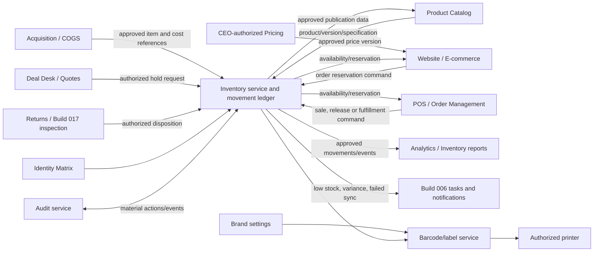

# Build 008 — Enterprise Inventory Management & Product Intelligence Engine
## GitHub Platform Edition

**Company:** Much More Electronics  
**Development platform:** GitHub for source control, automation and deployment governance  
**Application:** MME OS; backend is the authoritative inventory operating system  
**Build number:** 008  
**Status:** Specification for implementation approval; not implemented  
**Authority:** CEO, exercised through approved pricing, acquisition, inventory and access policies  
**Dependencies:** Builds 001–007  
**Related build:** Build 017 — Returns and Refunds Condition Inspection (referenced by the supplied roadmap; implementation dependency and interface must be verified, not assumed)  
**Repository:** `lynchcous-wq/mme-os`

## 1. Purpose and architecture boundary

Build 008 defines the product catalog, inventory lifecycle, unit identification, acquisition/COGS, approved pricing, receiving/inspection, location operations, reservations, sales-channel publication, labels, cycle counts, returns disposition, analytics and workflow integration required to manage electronics from acquisition to final sale or disposition.

GitHub manages inventory application source, migration scripts, API contracts, tests, reviewed configuration, security checks and deployment workflows. GitHub is not the live inventory database and GitHub Actions must not directly modify production inventory. MME OS backend services own inventory commands and records; POS, website, Deal Desk, acquisition, pricing, payments, shipping and returns integrate through authenticated, versioned APIs/events. No module silently overwrites another module's system-of-record data.

This is a specification only. The repository currently has a storefront shell and documentation; no product database, stock ledger, receiving workflow, pricing integration, barcode service, POS integration, live website inventory sync or acquisition service is claimed to exist. Re-inspect the actual Replit runtime, data stores, deployment configuration and provider setup before implementation. Preserve existing behavior and make reviewed, additive changes.

## 2. Domain ownership and inventory architecture

| Domain/record | Authoritative owner | Inventory integration rule |
|---|---|---|
| Product identity, descriptions, specifications and media metadata | Product Catalog | Inventory links to stable Product ID and version; product text is not copied as an independent authority |
| Serialized physical unit and quantity by location | Inventory Management | Inventory movement ledger is authoritative for stock, reservation and disposition |
| Acquisition source, auction batch and item-level cost evidence | Acquisition/COGS Engine | Inventory consumes approved cost references and provenance; no equal-per-pallet default |
| Landed cost calculation and method | Acquisition/COGS, with inventory valuation policy in Accounting | Preserve item-level derivation, component, allocation method/version and approval |
| Approved active selling price and markdown rules | CEO-authorized Pricing System | POS/website/Deal Desk consume published approved versions; inventory cannot independently change price |
| Sale/order/fulfillment transaction | POS/Order Management by channel | Inventory processes authorized reservation/commit/release commands; sale source remains authoritative |
| Payment/refund state | Payments Center/provider; Returns for eligibility/disposition | Inventory consumes verified references; it never marks a payment/refund complete |
| Return condition and authorization | Returns and Refunds, including Build 017 inspection if established | Inventory only changes disposition from an authorized return outcome |
| Product website listing state | Catalog/E-commerce publication workflow | Inventory supplies availability/Coming Soon eligibility; publication approval is separate |
| Barcode/label design and logo asset | Central Brand Settings / approved label service | Labels use approved asset reference and controlled templates, not an uploaded arbitrary logo |
| Inventory analytics | Governed BI projection | Read-only derived data with source/freshness; not a stock mutation interface |
| Employee permissions and audit | Identity Matrix / Central Audit Service | Enforce role, location and action scope on every inventory operation |

### 2.1 Logical architecture

This is a logical design, not proof of existing services, interfaces, selected vendors or deployment topology.

## 3. Product catalog and item model

### 3.1 Product identity

Every catalog product receives a stable unique MME Product ID. Distinguish the **product/model** from an **inventory unit/item**: a single product model can have many physical units, each potentially with its own serial/IMEI, condition, cost basis, location and lifecycle. Use unique opaque IDs; SKU, UPC/EAN, model and serial are identifiers/attributes, not substitutes for the internal stable key.

Product catalog fields include MME Product ID, name, brand, manufacturer, model, SKU, UPC/EAN when available, category/subcategory, description, approved images/videos, structured specifications, warranty, condition grading schema/reference, tracking method and catalog/listing status. Catalog versions preserve history. Validate identifier collisions and allow missing UPC/EAN or supplier codes where not applicable.

### 3.2 Categories and specification schemas

Support televisions, laptops, tablets, cellphones, smartwatches, accessories, audio, gaming, smart-home, computer equipment, electronics services, accounts and subscriptions. Category-specific, versioned schemas should validate relevant attributes without forcing unrelated fields onto other product types.

- **Televisions:** screen size, resolution, display technology, smart platform, refresh rate, HDR, audio, HDMI ports, connectivity, model and warranty.
- **Laptops:** processor manufacturer/model/speed, RAM, storage capacity/type, screen size/resolution, graphics, OS, battery condition, connectivity.
- **Cellphones:** manufacturer/model/storage, carrier/network compatibility, screen condition, battery health, activation-lock status, IMEI/serial, warranty.
- **Tablets:** manufacturer/model/storage, screen, processor, OS, battery, connectivity and included accessories.
- **Smartwatches:** manufacturer/model, compatibility, display/battery condition, connectivity and included accessories.

Do not expose IMEI, serial numbers, activation-lock evidence, supplier documents or sensitive unit-level cost information on public product pages. API responses and exports must also enforce this boundary, not just hide fields in the UI.

### 3.3 Condition grading

Supported classifications: New, Open Box, Like New, Refurbished, Used — Excellent, Used — Good, Used — Fair, Parts Only, Damaged and Inspection Required. Define objective, category-aware criteria, required tests, permitted cosmetic defects, accessory completeness, warranty implications, customer-facing descriptions, and who may grade/approve each state. Keep condition grade separate from sale/availability status.

Inspection Required is not sale-ready. Damaged, Quarantined, Parts Only and Written Off states are excluded from normal availability unless a specific authorized listing policy permits a clearly disclosed sale. Record grader, checklist version, evidence references, timestamp and changes.

## 4. Inventory units, statuses and movement history

### 4.1 Trackable inventory

Support quantity-tracked products and individually serialized units. A unit record may reference Product ID/version, unit ID, acquisition batch, supplier, purchase and landed-cost references, serial/IMEI vault reference, condition/inspection record, location, receiving time, reservation/order/return references and lifecycle state. Keep restricted identifiers encrypted/masked and accessible only to approved roles and purposes.

### 4.2 Status model

Required business statuses include Incoming, Awaiting Receiving, Received, Inspection Required, Available, Reserved, Sold, Returned, Damaged, Quarantined, Transferred and Written Off. Website listing states are separately Draft, Pending Approval, Coming Soon, Available, Out of Stock, Discontinued and Removed. Define transition tables per entity; do not treat these two state families as interchangeable.

Each transition validates actor permission, previous state, preconditions, quantity/unit, location and related source record. Maintain an append-only or versioned movement ledger with from/to location/status, quantity, unit IDs, actor/service, time, reason, source command/event, correlation ID and approval reference. Corrections use compensating movements, not silent edits or deletion.

### 4.3 Quantity semantics

Define and report separately: physical on-hand, available-to-promise, reserved/held, incoming, inspection/quarantine/damaged, sold/fulfilled, and written-off. An item in reservation is not sold. An order/payment is not inferred solely from stock movement. Avoid double-counting between physical location, transfer-in-transit and destination receipt.

## 5. Acquisition, COGS and variable landed-cost allocation

Connect to the previously specified Acquisition/COGS Engine through a versioned contract. CEO intake may include auction purchase price, CSV, supporting documents, auction metadata and item titles/tracking information. Treat uploads as untrusted: validate size, encoding, schema, malware, access and provenance; store originals only in approved restricted storage under retention rules.

AI may extract/normalize titles, identify possible brands/models/variations, research comparable retail/market sources, estimate resale opportunities, calculate a proposed allocation, flag missing/conflicting data and prepare reports. Research output must include source, capture time, comparability assumptions and uncertainty. AI does not decide final acquisition, cost, listing, price, markdown or release.

### 5.1 Cost components and methods

Support verified item-specific purchase cost and CEO-approved allocation methods including item-specific allocation, weight, volume, relative value, or another documented method. Include applicable freight, auction/buyer fees, taxes, handling and other acquisition expenses, with each component's source and allocation basis. Choose a method per cost pool based on causal relevance; do not automatically divide total pallet cost equally across items.

For shared cost pool `C`, an approved method may allocate `C_i = C × w_i / Σw`, where `w_i` is a validated item-specific basis (for example measured weight, volume, or approved relative value). Preserve source inputs, weights, formulas, rounding rule, currency, rate/source, method version, per-item result, unallocated residual and reviewer approval. Directly attributable costs should be assigned to the specific item where supported. Do not mix currencies or silently discard rounding differences.

Inventory stores links to approved acquisition/COGS records rather than recomputing a competing cost. Accounting establishes valuation and cost-recognition policy. Revaluation, write-off and corrections are controlled, versioned and auditable.

### 5.2 CEO approval gates

CEO or authorized delegate review is required according to policy for acquisition records, cost allocation, pricing recommendations, product activation, inventory release and markdown policies. Approval is bound to the exact proposal/input version; edits invalidate approval. Proposed, approved and executed states are distinct. AI cannot independently authorize purchasing, final landed costs, selling prices, markdowns, or inventory release.

## 6. Pricing intelligence

Inventory read views may display acquisition cost, approved allocated landed cost, current approved selling price, estimated retail comparison, gross-profit/margin calculation, promotion, markdown history and approval status, subject to role restrictions.

`Gross profit = Selling price − Landed cost`

`Gross margin % = (Selling price − Landed cost) / Selling price × 100`, when selling price is greater than zero. Define behavior for zero/negative price, taxes, discounts, fees, returns, currency and cost version. Calculations use decimal-safe money and explicit currency; rounding rules are documented. Estimated retail comparison is not an approved price or guaranteed market value.

Authorized users may submit markdown requests. CEO/approved policy may define minimum margins, category/aging rules, promotions and clearance thresholds. Pricing service owns the active approved price version. Inventory may reject publication when approval is missing or expired but may not independently modify price. Record proposer, approver, reason, old/new version, effective time, channel and audit reference.

## 7. Receiving and inspection

Receiving workflow:

1. Resolve approved acquisition/purchase record or expected shipment.
2. Record receipt event, date, supplier/batch, receiving location and responsible user.
3. Scan product identifier or locate catalog item; never treat an unknown barcode as permission to create or alter product/pricing.
4. Verify expected versus actual quantities and unit identities; create discrepancy task when they differ.
5. Capture serial/IMEI only when required; validate format and duplicate active identifiers.
6. Perform category-appropriate condition and functional checklist.
7. Document missing accessories, defects, test results and photos/evidence where required.
8. Record grading/checklist version, inspector, and any review/approval.
9. Place failed, uncertain or incomplete units into Inspection Required/Quarantined/Damaged as appropriate.
10. Assign a valid location; release to Available only when all product, cost, pricing, condition, approval and receiving rules pass.

Inspection coverage may include screen, battery, camera, ports, speakers, connectivity, activation lock, physical grade and accessories. Test procedures and evidence requirements vary by product category. Build 017 is referenced as Returns and Refunds Condition Inspection; verify its approved scope/interface and sequencing before implementing a shared inspection component. Do not assume it exists.

## 8. Serial and IMEI governance

For uniquely tracked devices, associate serial/IMEI with the inventory unit, product, acquisition batch, receiving date, condition, location, sale/order and return history. Enforce uniqueness for active assignments within the appropriate identifier namespace; handle manufacturer reuse/format variation through validated rules and authorized exception review rather than silently accepting collisions.

- Encrypt restricted identifiers at rest and in transit, mask in ordinary views, and use purpose-limited lookup.
- Keep identifiers out of customer pages, public APIs, search suggestions, ordinary notifications, GitHub data, logs and unapproved exports.
- Restrict bulk lookup/export; log authorized access with actor, purpose, target and outcome.
- Define retention after sale/return, correction, legal hold and deletion policy before production.
- Verify activation-lock data only through authorized, lawful sources; do not bypass device security controls.

## 9. Locations and transfers

Support multiple locations: main warehouse, showroom, restricted stockroom, receiving, inspection, damaged goods, quarantine, shipping staging and customer pickup. Location records include stable ID, type, status, permitted operations and scope. Inventory movement uses unit/quantity and source/destination locations with audit.

Transfer workflow: request → policy approval where required → reserve units at source → dispatch/release into in-transit state → destination receipt/inspection → reconcile quantity/condition → close. A transfer is not complete at source dispatch alone. Missing/extra/damaged transfer units create an exception and do not silently adjust totals. Restrict source/destination access by role/location; allow authorized managers to reconcile with reason and approval.

## 10. Reservations, availability and sales-channel integration

Connect Inventory with POS, website, Deal Desk/quotes, shipping and pickup. A reservation includes ID, customer reference where authorized, product/unit/quantity, location, created/expiry time, order/quote reference, channel, status and idempotency key.

Support online orders, store sales, pickup, shipping, approved quote holds and temporary holds with separate policies, expiry and release rules. Use atomic/concurrency-safe reservation or equivalent so simultaneous sales cannot oversell. Quote holds are not orders or sales. Expired/failed orders release only according to owning policy. Commit inventory reduction/movement only on the defined authorized sale/fulfillment transaction; keep payment, order, reservation and fulfillment states distinct.

Availability APIs provide a versioned view with source time, location, quantity class and freshness. If inventory is stale/unavailable, fail safely under documented policy; do not claim stock is available based on stale cache. Use idempotent commands for reserve, commit, release and adjustment; reconcile duplicate/out-of-order events.

## 11. Website publication and Coming Soon

Product listing and stock availability are separate authorities. Listing payload may contain approved title, brand/model, description, media, public specifications, condition, approved selling price, warranty, shipping/pickup eligibility, badges and availability. Exclude internal unit cost, supplier/confidential records, IMEI/serial and restricted inspection evidence.

### Coming Soon

1. Approved acquisition/product record is received and validated.
2. Authorized product details, public condition/description and approved price/listing policy are prepared.
3. E-commerce publication approval is recorded.
4. Listing may be Coming Soon with a clear statement that physical inventory has not been received and the item cannot be purchased as immediately available.
5. Receiving and inspection confirm actual units.
6. Inventory provides fresh availability and authorized release state.
7. Listing becomes purchasable only when required price, condition, inventory and channel checks pass.

Synchronize the MME website through secured APIs/events and explicit ownership. Wix is specified as a target in the supplied requirements but must be verified as the actual platform and selected integration before implementation; do not assume Wix is configured. Webhook/API changes are authenticated, versioned, idempotent, monitored and reconciled. Product sync failure creates a Build 006 actionable alert while preserving source inventory truth.

## 12. Barcode and label printing

Established requested label settings: 2 × 3 inch paper, MME logo enabled, QR disabled by default, information density automatic. Support individual/batch printing, reprint authorization, product lookup, barcode validation, printer selection, preview and print history.

Label fields may include MME Product ID, name, brand/model, SKU, condition, approved selling price, barcode and a serial reference only when specifically authorized and safe. Prefer a non-sensitive opaque serial reference rather than the full IMEI/serial. Label layout and price must use current approved versions. Reprints, price changes and batch jobs are attributable and permissioned.

Retrieve the logo from approved centralized brand settings. The optional written format “Much More Electronics” may be used for approved document/barcode layouts; do not insert it into ordinary product-description body text. Barcode scanning resolves an identifier and checks actor/action permissions; a barcode never independently authorizes a price override, stock adjustment, sale or disclosure of restricted fields.

Printer integration, label language/symbology, supported models, calibration and offline/reprint handling require implementation decisions and hardware tests. Print history proves a job was issued, not that the physical label was correct; include operator verification where required.

## 13. Inventory counts, adjustment and reconciliation

Support full, department, location, category, random, high-value and serial-number counts. A count session records scope, expected snapshot/version, counters, start/end, blind-count policy, observed values, evidence, variance, reviewer and state.

Reconciliation: generate expected balance → authorized employee performs physical count → compare actual/expected → record variance and explanation → manager review → required approval → post compensating inventory adjustment → preserve original count and adjustment history. Employees cannot erase a variance or silently alter an expected quantity. Segregate counter and approver where feasible; high-value or repeated variances may require additional review.

Adjustments include reason code, actor, item/location, quantity delta, source evidence, approval, timestamp and correlation ID. Reconciliation against POS/orders, transfers, receiving, returns and write-offs is a recurring controlled process. A dashboard discrepancy is not itself an authorized correction.

## 14. Returns and refunds integration

When a return is submitted, RET retrieves the original sale/order and authorized product/unit reference, verifies identity, captures restricted identifier through a permitted flow, records condition/defects, determines disposition, routes approval, and requests payment refund through PAY where eligible. Inventory changes only after an authorized disposition event.

A return can result in Available only after required inspection and approval. Other outcomes include Quarantined, Damaged, Repair, Parts Only, supplier return or Write Off, according to policy. Refund state and stock disposition remain separate; a refund does not imply restock and restock does not imply refund. Accounting receives authoritative references. Build 017 is a related dependency in the supplied roadmap; verify build status, schema/API ownership and inspection rules before claiming integration.

## 15. Inventory analytics and Build 005/006 integration

Metrics may include quantity, cost value, estimated retail value, gross profit potential, turnover, inventory days, average age, sell-through, slow/fast movers, stockout frequency, shrinkage, adjustments, returns and aging. Provide product/category/brand/store/warehouse/acquisition batch/condition/employee-activity reports only for authorized scope.

Each metric has owner, formula, source, valuation date, currency, included statuses, cost/price basis, refresh/freshness, actual/estimated label and access scope. Distinguish physical/on-hand, reserved, incoming, inspection/quarantine and available. Estimated retail value and gross profit potential are clearly estimates unless backed by approved prices/costs. Employee activity views must avoid unnecessary surveillance and obey HR/Identity permissions.

Build 006 events may include low stock, receiving completion, failed inspection, missing serial, duplicate identifier, count variance, transfer completion, reservation expiry, website sync failure, aging threshold, write-off request and label-print failure. Events carry stable IDs, minimal payload and correlation; Build 006 owns tasks, notifications and escalation. Failed notification does not cancel the underlying inventory event or exception.

## 16. Security, data governance and GitHub controls

### Inventory security

- Identity Matrix role/action/location/department permissions on reads, search, scan, receive, inspect, transfer, reserve, adjust, write off, price view, export and configuration.
- CEO-controlled approval for designated acquisition, cost, pricing and release decisions; no role or barcode bypass.
- Restricted IMEI/serial access, encryption, masking, export logging and purpose controls.
- Secure API authentication, TLS, encryption at rest, secret manager, environment separation, input validation, rate limits, concurrency control, audit and session security.
- Append-only movement history and controlled migrations; production inventory cannot be modified by GitHub Actions or unauthorized scripts.
- Backup/restore, inventory reconciliation, incident monitoring and documented recovery; RTO/RPO to be approved.
- Public website payloads are allowlisted and contain no restricted unit/acquisition data.

### GitHub governance

Inspect repository settings/plan before claiming controls. Where approved and supported, configure protected branches/rulesets, CODEOWNERS, required reviews/checks, restricted Actions permissions, isolated environments, production deployment approvals, secret/dependency/code scanning, release versioning and integration docs. Use least privilege for workflow tokens and OIDC/short-lived credentials where supported. Never place production credentials or real inventory/customer/unit identifiers in source, Issues, commits, Actions logs or artifacts. GitHub Actions may validate migrations/tests and deploy reviewed software under approved gates; it must not directly write production inventory.

## 17. Implementation phases

1. **GitHub/project foundation:** inspect project, provider/configuration, workflows and data; document verified features, backup state, branch/security settings and migration strategy.
2. **Catalog and identifiers:** define catalog/unit schema, category attribute schemas, condition grading, Product ID policy and restricted identifier vault/access.
3. **Inventory operations:** implement movement ledger, statuses, locations, receiving, inspection, transfers, reservations, adjustments and cycle counting with audit/concurrency tests.
4. **Acquisition and pricing:** integrate approved acquisition/COGS and pricing contracts, per-item allocation methods/provenance, CEO approval/version binding and publication gates.
5. **Commerce and hardware:** integrate POS/website/Deal Desk, shipping/pickup, label service/printers and Returns/Build 017 only after providers/contracts are verified.
6. **Intelligence and automation:** build governed analytics, reconciliation, Build 006 alerts/tasks, and scoped AI research assistance with human approval and kill switch.
7. **Testing/release:** run synthetic-data and sandbox tests, security/recovery tests, physical label verification and controlled staged deployment before production.

## 18. Acceptance criteria and verification plan

Build 008 is ready for implementation approval when evidence demonstrates:

- [ ] Product catalog has stable unique MME Product IDs, category-aware specifications, versioned descriptions/media, and a distinct product-versus-unit model.
- [ ] Condition definitions/checklists are approved; Inspection Required and failed inspection products cannot become normally available without authorized release.
- [ ] Inventory quantity and movement history reconcile by unit/location/status; all material changes include actor, reason, source and audit reference.
- [ ] Serial/IMEI uniqueness and permissions work; restricted identifiers do not appear in public responses, ordinary logs, GitHub, labels or unauthorized exports.
- [ ] Acquisition and landed cost preserve source documents, per-item basis, method/version, components, rounding and CEO approval; unequal item values are not automatically allocated equal pallet costs.
- [ ] Pricing displays only active approved price versions; gross profit/margin formulas handle currency/zero price/rounding; proposals and actual prices are distinct.
- [ ] Receiving, inspection, missing-accessory evidence, location assignment and quarantine/failure paths work.
- [ ] Transfers reconcile dispatch, in-transit and destination receipt with discrepancy handling.
- [ ] Concurrent POS/website/quote reservations prevent overselling; reservation is distinct from sale; release/commit is idempotent and tested.
- [ ] Coming Soon listings clearly disclose not-yet-received status and cannot be purchased as immediately available; availability publishes only after required receipt/inspection/price approval.
- [ ] Website synchronization is authenticated, versioned, monitored and reconciled; Wix status is verified rather than assumed.
- [ ] 2 × 3 label, logo, QR-default-off and automatic density settings are supported and physically tested; reprints and restricted serial-reference behavior are audited.
- [ ] Cycle counts preserve expected snapshot, variance, explanation, review and approved adjustment; users cannot erase discrepancies.
- [ ] Return/refund and inventory disposition remain separate, integrate only with verified Build 017/RET contracts, and prevent automatic restocking of uninspected goods.
- [ ] Analytics reconcile to source records and distinguish actual, estimated and stale values; role/location filters and exports are enforced.
- [ ] Build 006 notifications/tasks respond to inventory events without duplicates and remain durable on delivery failures.
- [ ] Negative tests cover duplicate serial/IMEI, unauthorized adjustment, stale stock, concurrent reservation, forged/replayed webhooks, modified approved cost/price proposal, transfer loss, count variance, public identifier leakage, return auto-restock and GitHub Actions production write attempt.
- [ ] Existing storefront behavior is preserved; implementation commit, environment, test results, reviewer, provider limitations and known gaps are recorded.

## 19. Open decisions before implementation

1. Product and unit ID/UPC/SKU policy, serial/IMEI vault/storage, encryption/key access and retention.
2. Inventory database/ledger, concurrency/reservation model, event transport and migration/rollback strategy.
3. Category-specific grading standards, inspection test evidence, warranty policy and who may release inventory.
4. Acquisition cost-pool policy, supported currencies/exchange sources, allocation hierarchy, rounding/residual handling, accounting valuation and approval thresholds.
5. Pricing service contract, margin floors, price freshness, promotions, markdown aging and CEO/delegate authority.
6. Location hierarchy, transfer transit states, cycle-count frequency, blind-count/separation-of-duties rules and adjustment limits.
7. Website platform verification (Wix or other), API/webhook provider, listing ownership, Coming Soon policy and inventory freshness/oversell fallback.
8. POS/Deal Desk/Order/Shipping/RET APIs, idempotency semantics and transaction commit point.
9. Build 017 status, inspection component ownership and return disposition contract.
10. Barcode symbology, label renderer, printer hardware/drivers, logo formats, accessible label preview and reprint approval policy.
11. Inventory KPI formulas, cost valuation date, reporting timezone, BI freshness and export controls.
12. GitHub security features available on repository plan, production deployment topology, secrets/OIDC provider and on-call/recovery ownership.

## 20. Current completion boundary

This file records the Build 008 inventory architecture and acceptance specification only. No live catalog, inventory ledger, acquisition/COGS integration, pricing approval flow, receiving/inspection, serial/IMEI tracking, multi-location transfer, reservation service, website/Wix synchronization, barcode printing, cycle counting, returns/Build 017 integration, analytics or production security control is established or verified by this document. Do not declare Build 008 implemented or complete until capabilities are added to the existing MME OS project, integrations and hardware are verified, acceptance tests pass in the actual deployment environment, and accountable operations, finance and security owners review the evidence.
